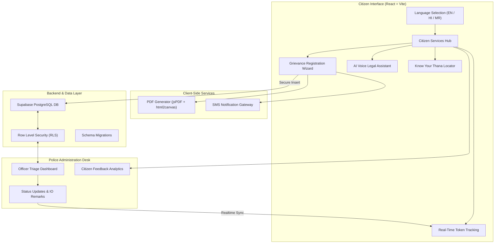

# 🛡️ SahAI (सहाय) — AI-Powered Smart Citizen Police Portal & Digital Thana Assistant

<p align="center">
  
  
  
  
  
  
</p>

<p align="center">
  <strong>Democratizing citizen access to law enforcement through transparent, multilingual, AI-assisted grievance redressal.</strong><br>
  Built by <strong>Team CodeCops</strong> — <em>Finalist Project at the Goa Police Hackathon 2025</em>.
</p>

---

## 🏛️ The Vision & Problem Statement

Visiting a physical police station (*Thana*) can be an intimidating and stressful experience for the average citizen:
- **Intimidation & Procedural Confusion**: Citizens often do not know the difference between an FIR, a Non-Cognizable Report (NCR), or a simple grievance, leading to anxiety and misfiled reports.
- **Language & Literacy Barriers**: Many citizens struggle to communicate technical legal terms in formal English or state-specific official administrative vernacular.
- **Lack of Tracking & Transparency**: Once a complaint is handed over on paper, tracking its investigation stage, assigned officer, or resolution timeline is often impossible without repeatedly visiting the station.
- **Heavy Administrative Burden on Police Staff**: Desk officers spend critical hours manually recording basic incident details, paper receipts, and answering repetitive jurisdiction queries.

**SahAI (सहाय)** bridges this trust gap by transforming the police-citizen interface into an empathetic, transparent, and intelligent digital kiosk and web portal.

---

## ✨ Key Features

### 1. 🌐 Trilingual Inclusivity (त्रिभाषी समर्थन)
- Native end-to-end localization in **English**, **Hindi (हिंदी)**, and **Marathi (मराठी)**.
- Designed with high-contrast accessibility typography to ensure elderly, rural, and stressed complainants can navigate without assistance.

### 2. 📝 Guided Digital Grievance Filing (ई-शिकायत)
- Step-by-step reporting wizard covering key incident categories:
  - 📱 Lost Mobile / Missing Property
  - 💻 Cyber Fraud / Online Financial Theft
  - 🚨 Harassment / Eve Teasing / Women's Safety
  - 🚗 Vehicle Theft / Road Accidents
  - 📢 Public Nuisance & General Grievances
- **Instant Official Token Generation**: Every submission generates a standardized serial (e.g., `2026/0042`).
- **Instant Printable PDF Receipt**: Generates a tamper-evident digital receipt directly in the browser via `html2canvas` and `jsPDF`.
- **Automated SMS Confirmation**: Real-time dispatch of SMS alerts via integrated messaging gateway for instant citizen reassurance.

### 3. 🎙️ AI Voice & Legal Assistant (एआई आवाज़ सहायक)
- Conversational voice-interactive assistant trained on Indian legal procedures (BNS / IPC, CrPC, citizen rights).
- Explains whether an incident is cognizable vs. non-cognizable, which documents are required, and what immediate steps to take (e.g., blocking SIMs or bank accounts during cyber theft).

### 4. 🔍 Live Investigation Tracking (शिकायत स्थिति)
- Real-time status lookup using the unique Token ID or Mobile Number.
- Transparent timeline reflecting three official stages:
  - 🟡 **Pending (लंबित)**: Received at the precinct dispatch.
  - 🔵 **Under Action (कार्रवाई जारी)**: Investigating Officer (IO) assigned and preliminary enquiry underway.
  - 🟢 **Completed (पूर्ण)**: Resolution report or official FIR registration filed with attached officer remarks.

### 5. 📍 Know Your Thana (अपना थाना जानें)
- Geo-jurisdiction locator helping citizens immediately pinpoint their designated local police station.
- Direct access to Station House Officer (SHO) contact details, control room helplines (112, 1091, 1930), and station emergency lines.

### 6. 👮 Officer Administration Desk (अधिकारी डैशबोर्ड)
- Dedicated, authenticated police officer portal:
  - Live complaint feed categorized by severity and submission time.
  - One-click status progression (`Pending` → `Under Action` → `Resolved`).
  - Officer notes & internal remarks logging.
  - Citizen satisfaction and response-time metric overviews.

### 7. ⭐ Citizen Feedback & Precinct Accountability
- Post-resolution rating system measuring officer courtesy, transparency, and speed of redressal.
- Feeds into high-level police administration analytics to recognize exemplary stations and address operational bottlenecks.

---

## 🏗️ System Architecture



---

## 🛠️ Tech Stack

| Layer | Technology |
|---|---|
| **Frontend Framework** | [React 18](https://react.dev/) + [TypeScript](https://www.typescriptlang.org/) |
| **Build Tooling** | [Vite 5](https://vitejs.dev/) |
| **Styling & Design** | [Tailwind CSS 3.4](https://tailwindcss.com/) with Civic Blue & Khaki accents |
| **Icons** | [Lucide React](https://lucide.dev/) |
| **Database & Auth** | [Supabase](https://supabase.com/) (PostgreSQL with RLS policies) |
| **Document Engine** | [jsPDF](https://github.com/parallax/jsPDF) & [html2canvas](https://html2canvas.hertzen.com/) |
| **Voice & Speech** | Web Speech Recognition & Synthesis APIs |
| **Messaging** | Custom REST SMS Gateway (`smsService.ts`) |

---

## 🚀 Getting Started

### Prerequisites
- **Node.js**: `v18.0.0` or higher
- **npm** or **yarn**
- A **Supabase** account (free tier works)

### Installation

1. **Clone the repository:**
   ```bash
   git clone https://github.com/Aayush-Singh07/SahAI.git
   cd SahAI
   ```

2. **Install project dependencies:**
   ```bash
   npm install
   ```

3. **Configure Environment Variables:**
   Create a `.env` file in the root directory:
   ```env
   VITE_SUPABASE_URL=https://your-supabase-project.supabase.co
   VITE_SUPABASE_ANON_KEY=your_supabase_anon_key
   ```

4. **Initialize Database Migrations:**
   Run the SQL migrations located in `supabase/migrations/` inside your Supabase SQL Editor:
   - `20250921100950_maroon_mouse.sql`: Creates `complaints` table, indexes, and initial RLS policies.
   - `20250921102324_fierce_river.sql`: Adds officer remarks and feedback tracking.

5. **Start the Development Server:**
   ```bash
   npm run dev
   ```
   Open [http://localhost:5173](http://localhost:5173) in your browser.

---

## 🏆 Hackathon Recognition

- **Event**: **Goa Police Hackathon 2025**
- **Problem Statement**: Smart Citizen-Police Interaction, Multilingual Redressal & Crime Reporting
- **Team**: **CodeCops**
- **Achievement**: **Finalist Round Selection**

---

## 👨‍💻 Team & Developer Profile

Developed by **Aayush Kumar Singh** & Team **CodeCops**.

- **GitHub**: [@Aayush-Singh07](https://github.com/Aayush-Singh07)
- **LinkedIn**: [Aayush Kumar Singh](https://linkedin.com/in/aayush-singh07)

---

<p align="center">
  <sub>Dedicated to enhancing transparency, accessibility, and public trust between citizens and our police forces. 🇮🇳</sub>
</p>

